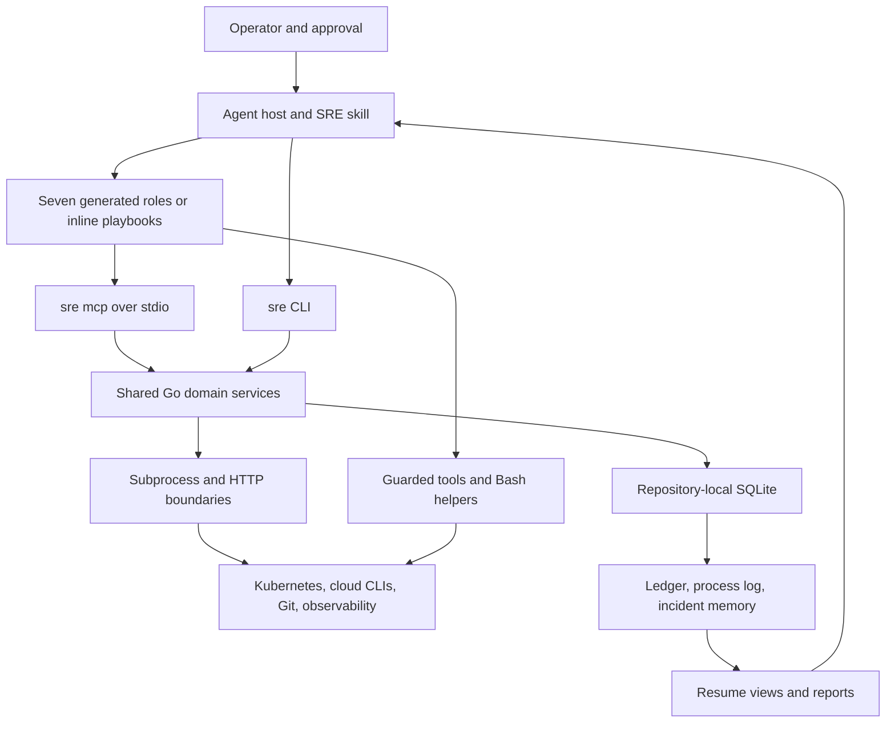

# Architecture

SRE Agent has two execution layers. An agent host reads the skill, dispatches
investigators where supported, interprets evidence, and requests human approval.
A local Go executable provides bounded evidence collection and durable records.
The executable contains no model loop and does not execute remediation commands
stored in the ledger.

The diagram shows data and control paths, not a security boundary. Claude's
configured investigator hooks inspect matching tool calls; cloud IAM and
Kubernetes RBAC remain the hard external restrictions. Approved changes are
performed by the host's authorized tools, outside the Go evidence services.

## Host and instruction layer

The [skill](../plugins/sre-agent/skills/sre-agent/SKILL.md) owns Phase 0 bootstrap
and Phases 1 through 6. It uses the [project memo](../plugins/sre-agent/skills/sre-agent/references/project-memo.md)
for previously verified structure and the [triage rules](../plugins/sre-agent/skills/sre-agent/references/triage.md)
for investigator selection and escalation. Seven [investigator sources](../plugins/sre-agent/skills/sre-agent/references/investigators/)
produce Claude Markdown agents and Codex TOML roles through the
[generator](../scripts/gen-sre-agent-artifacts.sh). The
[artifact check](../scripts/checks/sre-agent-artifacts.sh) regenerates into a
temporary directory and compares output. Edit the playbooks rather than their
generated copies when changing a role.

The Claude [hook manifest](../plugins/sre-agent/hooks/hooks.json) routes matching
pre/post calls through the launcher to the Go hook adapter. The
[wrapper](../plugins/sre-agent/hooks/readonly-guard.sh) identifies the seven
investigator roles and fails closed for them if the checker cannot start.
The [guard](../internal/guard/guard.go) and its command rules restrict recognized
operations; they do not inspect all script contents or guard the main
conversation. Codex roles inherit parent MCP policy, so role text alone cannot
restrict inherited tools. See the [host permission setup](../plugins/sre-agent/README.md#required-codex-investigator-permissions).

## Shared CLI and MCP services

[cmd/sre/main.go](../cmd/sre/main.go) delegates to the
[CLI parser](../internal/cli/cli.go). Domain packages implement discovery, logs,
Prometheus, timeline, ledger, process logs, incidents, and reports. The
[MCP adapter](../internal/mcpserver/tools.go) calls the same packages;
[parity tests](../internal/cli/mcp_test.go) exercise the two transports.

CLI commands normally return JSON with `ok`, `data`, `gaps`, and `errors`, or a
text view when requested. `sre mcp` serves only stdio, reserving stdout for
protocol messages. It exposes exactly `discover`, `logs_fold`, `prom_query`,
`timeline`, `recall`, `run_resume`, `ledger_add`, and `report`. Only `ledger_add`
is classified write. Annotations such as `readOnlyHint` are advisory. There is
no HTTP listener or authentication layer. Repository reads still open SQLite
and can create its directory, database, or migrations.

The MCP schemas reject unknown input fields and require nonempty context for
all four cluster tools, even inline logs and an explicit Prometheus URL. Resume
requires an explicit run and does not bind a session. Report has no file-output
argument. The [result boundary](../internal/mcpserver/result.go) measures the
final encoded result, including SDK fields, against 8000 bytes. Oversized reads
return `result_too_large` and a CLI route. An already committed append returns
a compact receipt so presentation size cannot erase its write identity.
[Schema tests](../internal/mcpserver/server_test.go) and
[budget tests](../internal/mcpserver/result_test.go) cover these contracts.

## Collection and external boundaries

[executil](../internal/executil/exec.go) runs subprocesses with deadlines and
bounded diagnostics. [Kubernetes execution](../internal/executil/kubernetes.go)
pins one context and rejects per-command target overrides. Discovery uses its
own shared context pin across parallel probes. Source credentials remain those
available to the local processes; the CLI does not provision access.

| Operation | CLI target selection | Collection behavior |
| :--- | :--- | :--- |
| `discover` | Explicit `--context`, then `SRE_KUBE_CONTEXT`, then current context when a cluster probe needs it | Parallel env/obs/aws/gcloud/github probes; `SRE_SKIP_CLUSTER=true` skips all subprocesses and reports local tool presence |
| `logs fold` on stdin | No context or cluster flags required | Folds supplied text; supplying pod/context flags selects pod validation |
| `logs fold --pod` | Explicit context, environment, then current context | Requires namespace and pod; streams a finite timestamped snapshot |
| `prom query --url` | No cluster context required by CLI | Calls the reachable HTTP(S) URL directly and preserves path prefixes |
| `prom query` without URL | Explicit context, environment, then current context | Requires one unambiguous discovered Prometheus service; uses an authenticated `kubectl proxy` on a private Unix socket |
| `timeline` | Explicit context, environment, then current context | Requires namespace; merges independent sources within one deadline |

Sources: [discovery](../internal/discover/discover.go),
[probes](../internal/discover/probes.go), [pod logs](../internal/logs/pod.go),
[Prometheus query](../internal/prom/query.go), [proxy](../internal/prom/proxy.go),
and [timeline](../internal/timeline/collect.go). The proxy is short lived,
restricts the selected GET path, exposes no TCP listener, and is cleaned up
on completion or failure. It is not a port-forward. Explicit endpoint guidance
must never be used to circumvent a permission denial.

Discovery retains successful probes when another fails. Timeline reports source
failures without discarding independent successes; absent historical coverage
is a gap rather than proof that nothing happened. Failed pod-log producers do
not yield a successful partial fold. Prometheus errors and warnings fail the
query. Timelines distinguish event time, retained revision context, local Git
committer time, and current firing alerts rather than treating them all as
proven deployment times. See [discovery tests](../internal/discover/discover_test.go),
[pod tests](../internal/logs/pod_test.go), [query tests](../internal/prom/query_test.go),
and [timeline tests](../internal/timeline/collect_test.go).

## Durable state and evidence lifecycle

[Store opening](../internal/store/store.go) resolves the Git repository root,
including linked worktrees, and uses `.sre-agent/sre.db`. Directory mode is 0700;
database mode is 0600. Store-owned symlinks and special files are rejected. The
pure Go SQLite driver supports CGO-disabled releases. WAL and a five-second
busy timeout support concurrent local processes. Compiled, contiguous
[migrations](../internal/store/migrations.go) run atomically under a write lock;
a newer schema is refused. Use local storage rather than a shared network
filesystem. [Store tests](../internal/store/store_test.go) exercise permissions,
migration rollback, concurrency, and linked worktree resolution.

Evidence reaches persistence only when the orchestrator records a typed ledger
entry. A collection command does not automatically append its output. The
[ledger service](../internal/ledger/service.go) redacts before committing,
validates same-run typed references, and serializes append sequence numbers.
Stable run/entry IDs enable retry; a conflicting payload under an existing
entry ID fails instead of replacing history. State is reduced from the
append-only history, including metadata, evidence, hypotheses, expected
behavior, options, approvals, actions, validations, and safety violations.

Resume returns current state plus bounded history. Paging and truncation are
presentation concerns; validation evaluates complete stored history. Commit
receipts survive presentation failure, and output failure diagnostics identify
committed writes for recovery. See [ledger rendering](../internal/ledger/render.go)
and [CLI recovery tests](../internal/cli/ledger_test.go).

The [process log](../internal/processlog/log.go) stores sanitized command/path
metadata for observed investigator hook calls, keyed by session and tool-use
ID. Explicit `SRE_RUN_ID` takes precedence over a bound session; hooks never
select the latest run. Post events reconcile outcomes with pre events. Allowed
does not mean executed, absent timing stays unknown, and contradictory events
produce conflicts. Missing hook delivery means missing records. It is not an
archive of raw requests, responses, or failures. See the
[hook adapter](../internal/cli/hook.go) and [reconciliation tests](../internal/processlog/log_test.go).

[Incident capture](../internal/incident/capture.go) projects a validated ledger
snapshot into a historical record. It requires an explicit run, approved
applied action, and passing current criteria, including declared observation
windows. [Recall](../internal/incident/recall.go) ranks service, symptom, and
fingerprint matches as historical candidates. The score is not causal confidence.
[Reports](../internal/report/report.go) use the same validation evaluator and
remain unresolved without a validated fix. They do not execute commands or
fetch linked evidence. CLI `--out` writes sanitized Markdown through an atomic
file replacement; MCP returns content only. See [validation](../internal/ledger/validation.go),
[capture tests](../internal/incident/capture_test.go), and
[report tests](../internal/report/report_test.go).

The project memo at `docs/sre-agent-memo.md` and legacy/manual incident files at
`docs/sre-incidents/` belong to separate skill workflows. Go does not import,
export, stage, commit, or push them. The skill's memo write-back instructions
remain subject to the operator's repository and approval rules.

## Data handling and remaining helpers

[safety](../internal/safety/safety.go) redacts recognized secrets and creates
fresh random external-data boundaries. Size/complexity limits and cancellation
checks bound processing of external JSON. Stored text, errors, labels, and
historical reports remain untrusted. Redaction and markers reduce exposure and
instruction confusion; neither guarantees that all secrets or malicious content
are recognized.

Bash helpers remain under [skill scripts](../plugins/sre-agent/skills/sre-agent/scripts/):
discovery/evidence fallbacks, before/after snapshots, cloud and GitHub evidence,
Terraform plan classification, Pulumi previews, and Crossplane status checks.
Trace and mesh recipes remain in the references. The launcher never silently
runs those alternatives when a download fails. The operator or host selects an
available permitted fallback and records its limitations. A blocked operation
must remain blocked. Snapshot success covers only the selected fingerprints,
not proof that all infrastructure remained unchanged.
