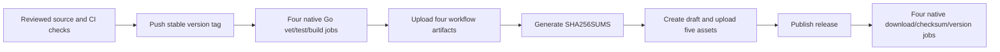

# Releases and maintainer checks

The current packaged version and launcher pin are `v0.17.0`. The
[release](https://github.com/glapsfun/sre-agent/releases/tag/v0.17.0) contains four
native executables plus `SHA256SUMS`:

```text
sre_v0.17.0_linux_amd64
sre_v0.17.0_linux_arm64
sre_v0.17.0_darwin_amd64
sre_v0.17.0_darwin_arm64
SHA256SUMS
```

The recorded [v0.17.0 workflow run](https://github.com/glapsfun/sre-agent/actions/runs/43203305040)
succeeded in all nine jobs: four native builds, publication, and four downloaded
native verification jobs. This is evidence for that release, not a substitute
for checking the exact tag and assets of a later release.

## CI and release triggers

[CI](../.github/workflows/ci.yml) runs on pull requests to `main` and pushes to
`main`. Four native platform jobs run Go formatting checks, vet, tests, and a
CGO-disabled build, then execute JSON and text version commands. Fast checks
install developer tooling and run formatting, lint, structure, manifest,
generated-artifact, JSON, YAML, and shell validation. Slow checks validate
Markdown links, run shell/fixture tests, perform an install smoke test, and
scan for secrets. CI does not publish a release.

[Release](../.github/workflows/release.yml) runs on tag pushes matching `v*`.
Each build job additionally requires the exact stable form `vMAJOR.MINOR.PATCH`;
a prerelease-shaped tag can trigger the workflow but fails that validation.
Release jobs run their own Go vet/tests. They do not automatically run the full
CI shell, documentation, packaging, install, and secret checks first. A
maintainer must ensure the intended source passed those checks before tagging.



## Version consistency

A release adopts one version across these independent places:

- [Claude plugin manifest](../plugins/sre-agent/.claude-plugin/plugin.json),
  [Codex compatibility manifest](../plugins/sre-agent/.codex-plugin/plugin.json),
  [portable plugin manifest](../plugins/sre-agent/plugin.json), and
  [Gemini extension manifest](../plugins/sre-agent/gemini-extension.json) use
  `0.17.0` without the tag prefix.
- The [launcher](../plugins/sre-agent/skills/sre-agent/scripts/sre) pins `v0.17.0`.
  Adopting another binary requires an explicit source change to that pin and
  corresponding fixtures/documentation.
- The tag and asset names use `v0.17.0`. The release build injects that same tag
  into `github.com/glapsfun/sre-agent/internal/cli.Version` with `-ldflags`.
  Plain `go build` leaves the [default version](../internal/cli/cli.go) as `dev`.

The [manifest check](../scripts/checks/manifest-versions.sh) verifies Claude and
Codex compatibility versions agree; [MCP packaging tests](../tests/sre-mcp-packaging.test.sh)
also compare the portable and Gemini versions with Claude. Neither is a complete
tag-to-launcher consistency gate. Check the tag, pin, fixtures, and manifests
together. The marketplace references the plugin directory and has no separate
version field to update.

## Build, publish, and verify

The release matrix is Linux and Darwin, each on amd64 and arm64, with native
GitHub runners. Every build uses the Go version from [go.mod](../go.mod),
`CGO_ENABLED=0`, `-trimpath`, and `-ldflags` containing `-s -w` plus the version
assignment. Before uploading its artifact, the job runs the executable and
asserts both `data.version == RELEASE_VERSION` in JSON and the exact text
`sre RELEASE_VERSION`.

Publication waits for all four builds. It downloads their artifacts, creates
`SHA256SUMS` with `sha256sum sre_*`, creates a draft GitHub release for the tag,
uploads every file in `dist`, then publishes the draft. The only release job
with repository write permission is `publish`.

Four post-publication jobs download their own native asset and the checksum
manifest from the public release URL over HTTPS. They verify one valid checksum
entry, hash the downloaded executable, display its platform information, and
assert the same JSON/text version values. The workflow has already published
by this point: a verification failure does not automatically unpublish or roll
back a release. There is no additional release helper or changelog-generation
step in the tracked release workflow.

For a manual installation, choose the exact asset for the target platform from
the release above, download its `SHA256SUMS`, verify the matching hash, then
make the executable runnable and check `version` before using it. Checksums
establish integrity relative to that manifest; the assets are not independently
signed provenance. A local source build is an alternative when the pinned asset
is unavailable, provided you trust and verify the source and build.

## Launcher caching and failure behavior

The Bash launcher selects only Linux/macOS and amd64/arm64. It uses OpenSSL
first, then sha256sum, then shasum. Cache-root precedence is `CLAUDE_PLUGIN_DATA`,
then `XDG_CACHE_HOME`, then `$HOME/.cache`, with nonempty values taking
precedence. The final path is:

```text
<CACHE_ROOT>/sre-agent/v0.17.0/<os>-<arch>/sre
<CACHE_ROOT>/sre-agent/v0.17.0/<os>-<arch>/SHA256SUMS
```

On a missing cache it creates a per-platform lock directory, rechecks for a
completed cache, downloads both files into private staging, verifies the hash,
sets executable permissions, and moves the staged directory into place. HTTPS,
connection/overall timeouts, and bounded retries apply to both downloads.
Concurrent download attempts fail with a retry diagnostic rather than racing
publication. Normal exit and handled signals clean up staging and the lock.

Every launch validates the cached executable against its cached manifest before
`exec`. A valid cache works without curl or network access, but still requires
a checksum tool. A missing cache with failed download exits nonzero. A changed,
invalid, symlinked, or nonexecutable cached artifact is refused. The launcher
does not silently run Bash fallbacks. The operator selects a verified source
build or an existing permitted helper for that operation and records the gap.

For a checksum failure, inspect the affected version/platform cache before
deliberately removing or replacing it and retrying online. After an interrupted
download, remove a stale lock only after confirming that no launcher is active.
Do not remove a lock held by another download. The manifest and executable are
both local trust inputs; modifying both consistently is outside the integrity
protection provided by a checksum comparison.

[Launcher fixtures](../tests/sre-launcher.test.sh) cover platform selection,
cache precedence, offline reuse, tampered caches/downloads, checksum backends,
and failure diagnostics without depending on a live GitHub release.

## Maintainer validation checklist

1. Confirm the intended source revision and inspect the diff. Keep version-only
   edits, the launcher pin, and release fixtures aligned with the intended tag.
2. Run `go vet ./...`, `go test ./...`, and the formatting check used by CI.
   Run `scripts/validate.sh --all`, `scripts/test.sh`, `scripts/lint.sh`, and
   `scripts/fmt.sh --check`. The shell suites use tracked files, so include new
   files in the index. Report skipped optional tools.
3. Include CI's explicit launcher checks:
   `shellcheck plugins/sre-agent/skills/sre-agent/scripts/sre` and
   `shfmt -i 2 -ci -bn -d plugins/sre-agent/skills/sre-agent/scripts/sre`.
   Run `scripts/install-test.sh` and `scripts/security.sh` in the intended
   validation environment. [Bootstrap](../scripts/bootstrap.sh) installs tools;
   review and authorize environment changes before running it.
4. Ensure the reviewed revision passed CI on all four platforms. Confirm that
   the stable tag will point at that revision and that all package versions and
   the launcher pin agree. Tag creation and pushing are deliberate maintainer
   actions, not part of the checks above.
5. After tag publication, inspect all build and publish jobs, the exact five
   release assets, checksums, and all four downloaded-native verification jobs.
   A green build alone is insufficient evidence that public assets are usable.

## Partial release recovery

Publication is **not automatically idempotent**. The workflow unconditionally
calls `createRelease`, then uploads assets sequentially. A failure after draft
creation or partway through upload can leave a draft with only some assets.
Blind reruns can fail because a release for the tag or an asset already exists.
A post-publication verification failure can leave a published release visible.

Inspect the exact tag, commit, draft/published status, asset names, sizes,
checksums, and job logs first. A maintainer then deliberately completes or
corrects that tag's assets, or removes an invalid draft under the repository's
approval rules before retrying. Recheck all native binaries and their version
against the same source. Do not force-move a tag or overwrite assets without
understanding which users or caches may already have consumed them. The
workflow contains no automatic reconciliation, rollback, or cache invalidation
for a partial or corrected release.
